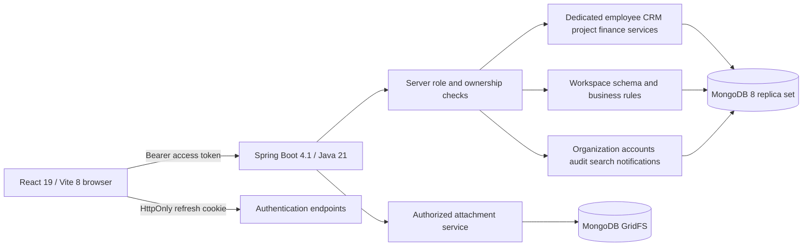

# PriyoniX One — Assignment handover

Prepared 22 October 2026 against the supplied **PriyoniX One ERP Intern Assignment Pack**. This document maps the assignment to the delivered application, describes the supported workflows, and identifies the decisions and operational evidence still required for company acceptance.

## 1. Delivery and acceptance boundary

The application contains a React frontend, Spring Boot API and persistent MongoDB storage for the business areas in the assignment. Existing employee, CRM, project, marketing and finance features are extended by twenty schema-defined business modules and platform administration services. The UI reads and writes real APIs; any demonstration records belong to an isolated verification database, not to bundled frontend fixtures.

**Implemented** in the matrices below means the screen, endpoint and business rule are present in code. It does not mean a business owner has accepted the feature or that production operation has been demonstrated. Test counts, browser observations, recovery results and local launch addresses must come from the verification evidence attached to this delivery. No historical test totals from the original README are carried forward as current results.

The assignment also requires stakeholder-approved requirements, company repository review, UAT, production deployment, recovery ownership and sign-off. Those remain separate acceptance gates. The 32-week schedule is a planning baseline in the assignment, not a timeline proven by this implementation.

## 2. Requirement-to-module acceptance matrix

Assignment references identify the source page and functional area. Scenarios describe what a reviewer should verify using synthetic or authorized records.

### Core platform and administration

| Assignment requirement | Delivered screen/API and implementation | Acceptance scenario and limit |
| --- | --- | --- |
| Organization settings — p.2 | Administration → Organization; `PlatformController` / `PlatformService` | Save company/legal names, contact details, currency preference, IANA time zone and fiscal-year start month; reload to verify persistence. Financial calculations remain INR regardless of the display preference. |
| Departments — p.2 | People & HR → Departments; `departments` workspace schema | Create a unique department code, assign an existing manager, deactivate/reactivate; use the department in a budget. Legacy employee department text has not become a foreign key into this catalog. |
| Users and account lifecycle — pp.2–3 | Administration → User accounts | Create ADMIN/EMPLOYEE accounts, change role, enable/disable; reject duplicate emails and invalid passwords. Current/last administrator safeguards prevent administrative lockout. |
| Roles and permissions — pp.2,6 | Administration → Roles & permissions; `SecurityConfig`, `WorkspaceService` | Employee requests to finance, organization-wide HR, audit/status and account-management endpoints are denied. Two fixed roles are delivered; there is no custom role designer or granular permission editor. |
| Authentication/session management — p.3 | Sign-in, forgot/reset-password screens; auth services | Verify login/logout, short-lived access tokens, optional refresh-cookie rotation and account checks. Reset flow code exists; SMTP delivery requires separately configured and verified mail infrastructure. |
| Audit logs — pp.2,6 | Administration → Audit trail; `AuditService`, audit interceptor | Perform a successful mutation and locate actor, action, resource and time in the audit search. There is no audit edit/delete route. Audit writes follow the business commit; atomic compliance auditing would require an outbox design. |

### CRM and project delivery

| Assignment requirement | Delivered screen/API and implementation | Acceptance scenario and limit |
| --- | --- | --- |
| Leads and lead-to-client conversion — pp.2–3 | CRM & sales → Leads; `LeadService` | Create/update a lead, move through supported statuses, convert a won lead, and reject invalid/double conversion. Conversion reuses the matching client when appropriate. |
| Clients — p.2 | CRM & sales → Clients; `ClientService` | Maintain client contacts/ownership and status; search/filter records and inspect linked follow-ups. Deletion obeys existing dependency restrictions. |
| Contacts — p.2 | CRM & sales → Contacts; `contacts` schema | Create a named contact with valid email, optionally link a client, archive and restore. |
| Opportunities — p.2 | CRM & sales → Opportunities; `opportunities` schema | Link a client/contact, record value and expected close date, progress QUALIFIED → PROPOSAL → NEGOTIATION → WON or LOST. A contact belonging to another client is rejected. |
| Quotations — p.2 | CRM & sales → Quotations; `quotations` schema and `BusinessRules` | Create a draft with one item/service, quantity, unit price and tax; verify server total; issue and accept/reject. An expired quote cannot be issued/accepted. No quote-to-invoice conversion or multi-item quotation is supplied. |
| Follow-ups — p.2 | CRM & sales → Follow-ups; `FollowUpService` | Schedule an assigned call/meeting/activity for a lead or client, filter due/completed items and mark completion. |
| Projects and assignments — p.2 | Projects & work → Projects; `ProjectService` | Create a project, assign employees/client, set dates/priority/status and inspect its delivery details. |
| Tasks and subtasks — p.2 | Projects & work → Tasks; `TaskService` | Create/assign a project task, update progress/status, maintain a subtask checklist and inspect overdue work. |
| Milestones — p.2 | Project form/detail | Save project milestones and dates; reload the project to verify their persistence. |
| Timesheets — p.2 | Projects & work → Timesheets; `timesheets` schema | Record own daily project time, submit and approve/reject. The backend restricts employee ownership and rejects aggregate active hours above 24 per employee/day. |
| Marketing, retained existing capability | Marketing → Campaigns; `CampaignService` | Maintain campaign dates/channel/status/budget/spend; associate actual leads and inspect derived conversion/pipeline measures. No advertising-platform synchronization is supplied. |

### HRMS and finance

| Assignment requirement | Delivered screen/API and implementation | Acceptance scenario and limit |
| --- | --- | --- |
| Employee records — p.2 | People & HR → Employees; `EmployeeService` | Maintain employee identity, work email, employment information and assignments. Employee accounts cannot access the organization-wide HR management API. |
| Attendance — p.2 | People & HR / My attendance & leave → Attendance | Record employee/date/presence/hours; verify attendance as administrator. Duplicate employee/day records, future actual dates and absent entries with nonzero hours are rejected. |
| Leave and approvals — p.2 | Leave requests; `leave` schema | Submit own leave dates/reason; approve/reject as administrator, revise rejected requests or withdraw submitted ones. Inclusive calendar-day totals and overlap guards are provided; no holiday calendar, accrual balance or payroll deduction engine is supplied. |
| HR reports — p.2 | Employee/attendance/leave lists and workspace CSV export | Filter records and export the permitted saved dataset. This supplies operational HR reporting; bespoke payroll/statutory HR report packs are outside the current model. |
| Invoices — p.2 | Finance → Invoices; `InvoiceService` | Create a client invoice with multiple lines, tax/discount/dates; inspect computed subtotal/total/balance. An invoice with any payment cannot be changed or cascade-deleted. |
| Receipts and payment tracking — p.2 | Finance → Payments and invoice payment detail; `PaymentService` | Record a receipt against an invoice, verify balance/paid status and reject overpayment. Payments are manual records; no payment gateway, bank feed or bank reconciliation is connected. |
| Expenses and approvals — p.2 | Finance → Expenses; `ExpenseService` | Create PENDING expense, approve/reject, reimburse approved expense or resubmit rejected expense. Approved/reimbursed expenses cannot be edited/deleted. |
| Budgets — p.2 | Finance → Budgets; `budgets` schema | Create a department budget for a period, approve and close. This is an approval register; it does not reserve spending or compute budget-versus-actual automatically. |
| Management/financial reports — p.2 | Finance overview, Financial reports and Reports | Inspect server-calculated invoiced/collected/outstanding/overdue/expense totals, monthly breakdown and CSV. Report date semantics and cash-basis calculation are documented below. No general ledger, balance sheet, statutory tax filing or scheduled report dispatch is supplied. |

### Procurement, assets, training and placement

| Assignment requirement | Delivered screen/API and implementation | Acceptance scenario and limit |
| --- | --- | --- |
| Vendors — p.2 | Procurement → Vendors; `vendors` schema | Maintain supplier identity/contact/tax reference, deactivate/reactivate. Orders require an active vendor. |
| Purchase requests and approvals — p.2 | Procurement → Purchase requests; `purchase-requests` schema | Create a request, submit, approve/reject, revise or withdraw. Employee-owned requests are API-supported; the employee sidebar intentionally omits procurement management. |
| Purchase orders — p.2 | Procurement → Purchase orders; `purchase-orders` schema | Create an order for an approved request, active vendor and supported quantity; place the order. One single-item order per approved request is the supported model. |
| Goods received — p.2 | Procurement → Goods receipts; `goods-receipts` schema | Post partial deliveries against an open order; received quantity updates the order to PARTIALLY_RECEIVED or RECEIVED. Reject quantity beyond the remaining balance or receipt dates before the order. No inventory warehouse/stock ledger or supplier-payables subsystem is supplied. |
| Asset register — p.2 | Assets → Asset register; `assets` schema | Save unique asset tag, category, value/date/location; inspect availability and status. |
| Asset allocation and return — p.2 | Asset detail lifecycle actions | Select an existing employee before allocation; return to AVAILABLE; retire an available asset. Allocation is a record workflow, not an electronic signature/handover document. |
| Maintenance — p.2 | Assets → Maintenance; `maintenance` schema | Plan work for an available asset, start it and observe MAINTENANCE status, complete/cancel and observe availability restored. |
| Courses — p.2, conditional company scope | Training & placement → Courses | Maintain course code, duration and fee; archive catalog entries. |
| Batches — p.2 | Training & placement → Batches | Link active course and trainer, set dates/capacity, start and complete a cohort. Capacity cannot be reduced below enrolled students. |
| Students — p.2 | Training & placement → Students | Enroll a student in an open batch, enforce capacity, complete or withdraw. Batch changes that would invalidate existing training/placement history are restricted. |
| Training attendance — p.2 | Training & placement → Attendance | Record/verify daily student attendance; require the correct enrolled batch and an actual date within the batch. |
| Assessments — p.2 | Training & placement → Assessments | Record scores against a positive maximum, verify percentage and publish. Score above maximum or a mismatched student/batch is rejected. |
| Placement tracking — p.2 | Training & placement → Placements | Track APPLIED → INTERVIEW → OFFERED → PLACED, or reject/decline. Confirmed placement requires a joining date and positive salary. No external recruitment/job-board integration is supplied. |

### Shared services and engineering deliverables

| Assignment requirement | Delivered artifact | Acceptance boundary |
| --- | --- | --- |
| Role-appropriate dashboards — p.2 | Admin overview, employee assigned-work overview, module summaries | Admin business metrics and employee-owned work must be reviewed under separate accounts. A hidden button is never the authorization boundary. |
| Search, filtering, exports — p.2 | Header search, module toolbars, paginated tables, CSV | Search returns only authorized results; lists include filters/page metadata; new workspace CSV exports all matching pages. Report exports are CSV, not a PDF-report engine. |
| Notifications — p.2 | Header notification panel; recipient-scoped read API | Review own messages and mark read. The latest 100 persisted notifications are returned; no push/SMS/WhatsApp/email notification transport is connected. |
| File handling — p.2 | Record-detail attachments, `AttachmentService`, GridFS | Upload/download PDF, PNG, JPEG, UTF-8 TXT/CSV up to 5 MB; reject unsupported/mismatched content and unauthorized access. Uploader/admin can delete; attached parents cannot be deleted first. Malware scanning is a production gap. |
| Responsive accessible UI — p.6 | Shared layout, native dialogs, legacy focus helper, labeled forms | Review desktop/mobile navigation, keyboard focus/Tab/Escape/return, validation, loading/empty/error states and table overflow. This is not an independent WCAG certification. |
| Database design and relationships — p.3 | Existing Mongo collections plus `WorkspaceRecord`, schemas, validation, indexes and transactions | Persist related records, reject bad references/duplicates/stale versions, preserve protected posted history. MongoDB is retained from the supplied project; the assignment's relational-schema deliverable requires explicit supervisor approval of this architectural deviation. |
| Migrations — pp.3,6–7 | Startup index bootstrap and legacy role migration | Index creation is idempotent and conflicting legacy data must be reconciled. There is no complete versioned data-migration framework or historical spreadsheet import/reconciliation pack. |
| Automated tests — pp.2–3,6 | Backend unit/API/security/business-rule tests, opt-in real Mongo tests, existing browser auth script | Test source exists. Only executed results with logs establish a pass; ordinary tests do not imply the opt-in replica-set tests ran. Attach final evidence separately. |
| Backup/recovery — pp.4,6–7 | `scripts/platform-backup.py`, operations guide | BSON/checksum/index manifest and isolated no-overwrite restore are supplied. A successful drill needs its report and application checks; scheduling, encryption, retention and recovery ownership remain company decisions. |
| Monitoring/deployment — pp.2,4,6 | Health/status APIs, Dockerfiles, local Compose and nginx config | Liveness and admin database/uptime checks exist. Compose is a local operating asset; its presence is not a verified run, staging deployment, alerting system or production release. |
| CI/CD, reviewed PRs — pp.2–4,6–7 | Build/test commands documented | No current CI workflow execution or company-approved merge is claimed. The delivered `.github` directory contains tooling metadata, not evidence of a passing CI pipeline. |
| BRD/SRS, weekly reporting and company sign-off — pp.3–7 | This traceability guide, scenario checklist and remaining-gates register | Company stakeholder interviews, formally approved scope, named owners, weekly intern submissions, UAT signatures and repository/credential ownership must be completed by the project organization. |

## 3. Architecture and data model

The original dedicated collections/services remain in place: users, employees, clients, leads, follow-ups, campaigns, projects, tasks, invoices, payments, expenses and authentication tokens. `workspace_records` stores the twenty new module types under a shared envelope; `WorkspaceSchemas` is the server-owned field, column and transition registry. The server rejects unknown/read-only input fields and calculates totals rather than trusting browser values.

| Record field | Meaning |
| --- | --- |
| `id`, `module` | Record identity and a known schema key. |
| `values` | Validated named fields, references and server-computed values. |
| `status` | Current allowed workflow state. |
| `version` | Optimistic-lock version required on update, transition and deletion. |
| `createdBy`, `createdAt`, `updatedAt` | Creator identity and persistence timestamps. |

Relationships include client → contacts/opportunities/quotes; employee/project → timesheets; employee → attendance/leave/assets; request/vendor → purchase order → goods receipts; asset/vendor → maintenance; course/trainer → batch → students → training attendance/assessments/placements; department → budgets. Reference validation and deletion guards operate in services, because MongoDB does not provide relational foreign keys. Unique business/secondary keys and transaction guards supplement validation for concurrent writes.

Multi-record mutations use `workspaceTransactionManager`. **MongoDB must run as a replica set.** A standalone database can answer a ping while still failing transaction-dependent writes. Organization settings, notifications, attachment metadata, audit events and concurrency guards have their own platform collections; attachment bytes are stored in GridFS.

## 4. API contracts

All protected endpoints require an authenticated account. Requests use JSON except multipart uploads; consistent error responses distinguish validation, authentication, permission, missing-resource and conflict errors. The API is authoritative even if a caller bypasses the interface.

| Workspace endpoint | Contract |
| --- | --- |
| `GET /api/workspace/schema` | Array of `{key,label,group,description,fields,columns,states,initialState,transitions}`. Fields declare type/required/options/reference; transitions declare from/to/label/adminOnly. |
| `GET /api/workspace/lookups/{module}` | Permitted reference choices as `[{id,label}]`; existing employee choices intentionally expose only ID/name for assignment. |
| `GET /api/workspace/{module}?search=&status=&page=1&size=20` | `{items,page,size,total,totalPages}`; one-based pages, size bounded to 100. |
| `GET /api/workspace/{module}/{id}` | An authorized record. |
| `POST /api/workspace/{module}` | `{values:{...}}`; server assigns initial state, identity and creator. |
| `PUT /api/workspace/{module}/{id}` | `{values:{...},version:currentVersion}`. |
| `PATCH /api/workspace/{module}/{id}/status` | `{status:targetState,version:currentVersion}`. |
| `DELETE /api/workspace/{module}/{id}?version=currentVersion` | Admin-only; rejects references and protected workflow states. |

Platform endpoints are `GET/PUT /api/platform/organization`, `GET/POST /api/platform/users`, `PATCH /api/platform/users/{id}`, `GET /api/platform/permissions`, `GET /api/platform/audit?page=&size=&search=`, `GET /api/platform/notifications`, `PATCH /api/platform/notifications/{id}/read`, `GET /api/platform/search?q=`, and admin-only `GET /api/platform/status`.

Attachments use `GET/POST /api/platform/attachments?module=&recordId=`, multipart field `file`, `GET /api/platform/attachments/{id}/download`, and `DELETE /api/platform/attachments/{id}`. Downloads require authorization and use attachment disposition, `nosniff`, sandbox CSP and no-store responses. Existing feature endpoints remain under `/api/employees`, `/api/clients`, `/api/leads`, `/api/projects`, `/api/tasks`, `/api/follow-ups`, `/api/campaigns`, `/api/invoices`, `/api/payments`, `/api/expenses` and `/api/finance`.

## 5. Business rules and report definitions

- **Approval requests:** timesheets, leave and purchase requests use DRAFT → SUBMITTED → APPROVED/REJECTED. Rejected requests can return to DRAFT; draft requests can be cancelled and submitted requests withdrawn. Only administrators approve/reject.
- **Posted history:** workflow states lock unsupported edits. Deletion also checks references, attachments and posted/approved/allocated status. Stale versions must be refreshed before retrying.
- **Dates and quantities:** reversed ranges, negative numeric values, invalid enums and unknown references are rejected. Actual attendance/time/assessment/receipt dates cannot be in the future. Leave counts both endpoints as calendar days and is limited to 366 days per request.
- **Quotes and purchase orders:** one line, INR, `subtotal = quantity × unitPrice`; subtotal and tax are rounded to two decimal places with `HALF_UP`; `tax = subtotal × taxRate / 100`; `total = subtotal + tax`. Tax rate is 0–100%. No discount, freight, foreign-exchange or statutory-tax ledger is implied.
- **Invoices:** multiple lines are supported. Rounded line amounts form the subtotal; a validated discount is subtracted before tax, then two-decimal `HALF_UP` totals are calculated. Invoice numbering and payment-related mutations have server-side integrity protection. Recorded payments prevent invoice editing/deletion.
- **Expenses:** PENDING → APPROVED/REJECTED; APPROVED → REIMBURSED; REJECTED → PENDING. Approved/reimbursed records are immutable through the expense edit/delete routes.
- **Finance reports:** invoiced totals exclude draft invoices. A date range selects invoices by issue date, payments by payment date and expenses by expense date. Outstanding is based on all-time payments against the selected invoices, not just payments inside the filter range. The reported net-profit figure is collected payments minus APPROVED/REIMBURSED expenses; this is the application's operational cash-basis measure, not audited accounting profit.
- **Report scope:** delivery/CRM/marketing counters in Business Reports describe current persisted records. Its date filter applies to the finance summary. Its CSV is the finance export, not a combined export of every module.
- **Training:** capacity is a whole positive number; scores cannot exceed a positive maximum; the percentage is server-calculated to two decimals. Attendance/assessments must match the student's batch and its dates.

## 6. Concise user and administrator guide

### Daily use

1. Sign in with the account issued by your administrator. Choosing a sign-in role does not grant that role; the stored account role determines access.
2. Select a business area in the sidebar, then use its section tabs. The `section` URL parameter preserves the current module when reloading or sharing an authorized link.
3. Use search/status filters and page controls to find records. **New record** opens the server-defined form; fields marked `*` are required. Reference selectors use existing saved records.
4. Open **View** to inspect details, lifecycle actions and supporting attachments. Save edits while the workflow permits them. If another user changed the record, refresh before resubmitting.
5. Use the available transition action to submit, approve, issue, allocate or complete work. A server error describes unmet dependencies or business rules; do not bypass it by changing a local status value.
6. Export CSV for offline review. Exports contain actual permitted records; treat downloaded customer, HR and finance data as company information.
7. Use header search for cross-module discovery and the notification panel for your own updates. Sign out when finished on a shared computer.

### Administrator setup

1. Configure Organization and review Roles & permissions. These are fixed role descriptions, not editable policy rules.
2. Create an employee record and a user account using the same work email. This links employee-owned attendance, leave, timesheets and assigned-work summaries.
3. Maintain departments, clients, employees and projects before creating records that reference them.
4. For procurement, create the vendor and purchase request, submit/approve the request, create/place the order, then post deliveries through Goods receipts. A receipt updates received quantity; it does not create a supplier payment.
5. For training, create course → batch/trainer → student before recording attendance, assessments or placements.
6. Review pending requests and finance decisions, then inspect the audit trail. Keep at least one enabled administrator; the API blocks disabling/demoting the last one.
7. Use System status to inspect database connectivity and record counts. Public health alone is a liveness signal.

### Recovery and operations

Follow [Platform operations and recovery](platform-operations.md) for local Compose, backup and isolated restore instructions. Keep connection strings and keys out of committed files. Protect snapshots because they contain business records, password hashes and attachments. The backup utility uses BSON, manifests and SHA-256 validation and refuses to restore over a nonempty destination; it is not a retention scheduler or an incident cutover plan.

## 7. UI/UX research and design decisions

The interface uses light content surfaces, dark navigation, restrained blue/teal accents, compact readable tables, one clear creation action, grouped navigation and responsive drawers. The sign-in page removes the decorative 3D scene so the form remains accessible on narrow screens. No generated visual concept or pixel-perfect comparison is claimed.

| Primary source | Applied decision | Deliberate boundary |
| --- | --- | --- |
| [Carbon Design System — Data table guidance](https://carbondesignsystem.com/components/data-table/usage/) | Put search/filter/export near the table, distinguish row actions from global actions, and place pagination below results. | Guidance informs the custom components; Carbon's React library, sortable columns and bulk-selection features are not claimed as installed or implemented. |
| [W3C WAI APG — Modal dialog pattern](https://www.w3.org/WAI/ARIA/apg/patterns/dialog-modal/) | Use native `dialog` for the new modal primitive, move/trap focus, support Escape and restore focus to the opener; retain explicit labels and close/cancel controls. | Older dialogs use a compatibility focus helper. Formal assistive-technology conformance remains a separate review. |
| [ERPNext documentation — Purchase Receipt](https://docs.frappe.io/erpnext/purchase-receipt) | Separate the commitment to buy from confirmation of delivery; associate receipts with orders and track partial receipt quantities. | This application implements a bounded single-item workflow. ERPNext's stock, warehouse, quality-inspection, supplier-payable and general-ledger capabilities are not part of this delivery. |

These sources were reviewed on 22 October 2026. They support interaction and workflow decisions, not a claim that this project implements or replaces those products.

## 8. Verification plan and acceptance evidence

The source includes unit/API tests for existing modules and targeted workspace, platform, security, attachment, audit and finance-integrity tests. `WorkspaceMongoIntegrationTest` is opt-in: set `WORKSPACE_MONGO_TEST_URI` to an isolated replica-set endpoint before running the corresponding Maven test. It uses its own synthetic database; an ordinary Maven run without that variable can skip it.

The final evidence should identify the exact source state, commands, environment, passed/failed/skipped counts, meaningful browser journeys, and remaining defects. A successful frontend build alone does not verify a business transaction. A passing mocked controller test alone does not establish MongoDB transaction behavior. No tests were executed merely to write this handover.

The delivery lead reports 472 Java tests passing with no failures, errors or skips, including two real-MongoDB tests; frontend lint/build passing; 169 original and 91 additional live checks passing; and a verified isolated restore of 231 documents across 18 collections, including GridFS, with BSON hashes, indexes and collection options checked. The authoritative execution details are in [Verification evidence](VERIFICATION.md). These are local checks, separate from company UAT or production acceptance.

| Review scenario | Required evidence |
| --- | --- |
| Separate admin/employee sign-in and direct forbidden API requests | HTTP status/results and separate UI observations. |
| Shared CRM → project/task → timesheet approval | Persisted IDs/references, changed statuses, reload evidence and invalid-owner case. |
| Attendance/leave ownership, overlap and daily-hour guards | Positive path plus duplicate/overlap/over-24-hour rejection. |
| Client invoice → partial receipt → remaining balance | Server totals, protected invoice edit/delete and overpayment rejection. |
| Vendor → approved request → order → partial/final goods receipt | Updated order totals/status plus concurrent over-receipt guard. |
| Asset allocate/return and maintenance start/complete | Both asset and maintenance state after each transition. |
| Course/batch/student → attendance/assessment → placement | Valid chain plus capacity/membership/score validation. |
| Attachments, audit, search and notifications | Authorized round trip, rejected unauthorized access, searchable audit entry and persisted read state. |
| Mobile navigation and modal keyboard behavior | Narrow/wide screenshots and focus/Escape/scroll observations. |
| Restart and isolated restore | Representative records survive restart; backup manifest/restore report plus recovered application checks. |

<!-- VERIFIED_EVIDENCE: the delivery lead may insert only executed command results and local launch details here. -->

## 9. Production gaps and company decisions

1. **Business approval:** name the business owner, technical lead and final approver; approve first-release scope, data classifications, tax/leave/numbering rules and acceptance scenarios.
2. **Currency and accounting:** INR calculations are fixed. Organization currency/time-zone preferences do not provide a multi-currency ledger or a global date-conversion engine. Define payroll, statutory tax, reversals, credit notes and audit-retention policy before extending finance.
3. **Workflow breadth:** quotes and purchase orders are single-line; budgets are registers; no warehouse inventory ledger, depreciation, fee collection, payroll or generalized approval-policy designer is delivered.
4. **Identity:** two roles, one organization, no multi-tenant isolation, SSO/MFA or custom permission editor. Employee-owned records rely on account email matching the employee work email. Account provisioning needs company ownership.
5. **External integrations:** no payment processor, bank, accounting, recruitment, messaging or advertising connector. SMTP reset delivery exists as configurable code and requires real-provider validation. Sandboxes, secrets, retries/rate limits and reconciliation must be designed for future integrations.
6. **Data lifecycle:** approve MongoDB versus the assignment's relational-model expectation, formalize versioned migrations, reconcile existing duplicates, define imports, deletion/retention policy and sensitive-field access rules.
7. **Security/scale:** add environment-specific TLS/security headers, authenticated private database access, secret rotation, malware scanning, load/performance testing, dependency/security review and operational alerting. Audit-after-commit reliability needs an outbox if atomic retention is required.
8. **Delivery operations:** establish reviewed company branches/PRs, protected main, CI/CD, staging, rollback, scheduled encrypted backups, recovery ownership and tested RPO/RTO. Local Compose files and an isolated restore utility do not establish those controls.
9. **Human acceptance:** complete training, business UAT, defect disposition, source/repository ownership, credential handover and formal sign-off. Do not mark the assignment's final handover checklist accepted solely from this document.

## 10. Supervisor acceptance record

| Control | Owner/evidence to record |
| --- | --- |
| Approved business scope and architectural decisions | Business owner / technical lead. |
| Source revision and reviewed PRs | Company repository references. |
| Automated/API/browser/recovery verification | Current delivery evidence and defect register. |
| Security and financial integrity approval | Named reviewer and disposition of material findings. |
| UAT approval | Named business users, agreed scenarios and acceptance date. |
| Production readiness | Deployment, monitoring, backup schedule, recovery owner and rollback evidence. |
| Final handover | Source, documentation, access ownership, training and authorized company sign-off. |

The delivered implementation is ready to be evaluated against this matrix. Acceptance remains with the company-appointed reviewer.
